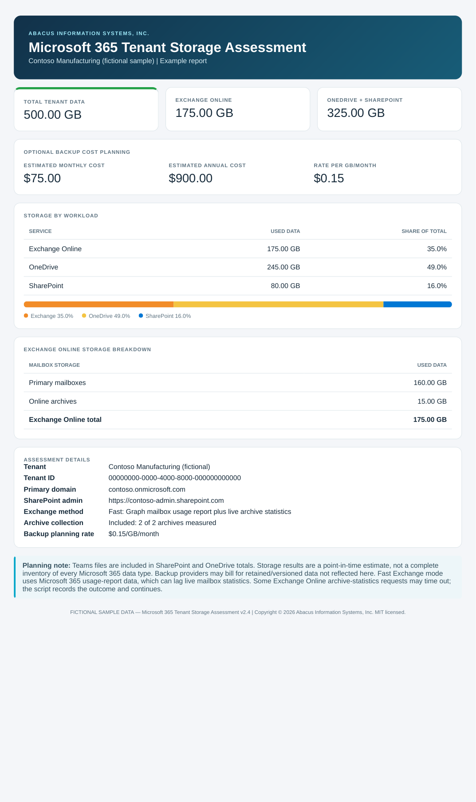

# Microsoft 365 Tenant Storage Assessment

**What's actually using storage in your Microsoft 365 tenant?**

A PowerShell 7 utility from **Abacus Information Systems, Inc.** that measures Exchange Online primary mailboxes and online archives, OneDrive, and SharePoint (including Teams-connected file storage). Produces a readable console summary, CSV export, and a standalone, client-ready HTML report. Optional backup cost estimates can be included.



## Requirements

- **PowerShell 7.2 or later** (`pwsh`), Windows administrative workstation.
- Microsoft 365 administrator with sufficient permissions for Microsoft Graph reports, Exchange Online mailbox statistics, and SharePoint Online site statistics. Tenant consent or admin roles may be required.
- Internet connectivity and interactive authentication. **Multiple sign-ins are normal**: Graph, Exchange Online, and SharePoint maintain separate sessions. Confirm you're authenticating to the intended tenant each time.
- Required PowerShell modules: `Microsoft.Graph.Authentication`, `Microsoft.Graph.Sites`, `Microsoft.Graph.Reports`, `ExchangeOnlineManagement`, and `Microsoft.Online.SharePoint.PowerShell`. The script checks/installs missing modules; first-run prompts may appear.

## Quick start

Download `M365-Tenant-Storage-Assessment.ps1` and open **PowerShell 7** in its folder. To allow the unsigned script for **this session only**:

```powershell
Set-ExecutionPolicy -Scope Process -ExecutionPolicy Bypass
.\M365-Tenant-Storage-Assessment.ps1
```

Enter the Microsoft 365 administrator UPN when prompted; review detected tenant and SharePoint admin URL. Complete any browser sign-ins. By default, results go to `Documents\M365-Storage-Assessments`, and the HTML report opens automatically.

> **Execution policy note:** Your organization's policies may override process-scoped settings. Do not bypass security controls without authorization.

## Options

```powershell
# Add estimated backup costs using an assumed $0.15 per GB/month
.\M365-Tenant-Storage-Assessment.ps1 -IncludeBackupEstimate -BackupPricePerGB 0.15

# Query live Exchange mailbox statistics instead of the Graph usage report
.\M365-Tenant-Storage-Assessment.ps1 -ExchangeMode Exact

# Skip archive queries
.\M365-Tenant-Storage-Assessment.ps1 -SkipArchives

# Do not open HTML automatically
.\M365-Tenant-Storage-Assessment.ps1 -NoOpenReport

# Choose an output directory
.\M365-Tenant-Storage-Assessment.ps1 -OutputFolder 'C:\Reports'
```

## Reading the results

- **Fast mode (default)** uses the Microsoft Graph mailbox usage report for primary mailboxes and live Exchange queries for active archives. Graph reporting may lag live mailbox statistics.
- **Exact mode** queries live Exchange mailbox statistics and can take substantially longer.
- **Archives** are included by default; failed or timed-out archive queries may leave the total understated and should be reviewed.
- **Teams files** are counted via their SharePoint/OneDrive storage. Teams messages/chats and every other Microsoft 365 data type are **not** separately inventoried.
- **Backup estimates** are illustrative planning calculations, **not a vendor quote or guaranteed invoice**. Backup-retained, deleted, and versioned data may increase actual billing.
- Results are point-in-time estimates. Validate unusual figures before relying on them for purchases or client proposals.

## Documentation and examples

- [Usage and Sharing Guide (PDF)](docs/M365-Tenant-Storage-Assessment-v2.4-Abacus-Guide.pdf)
- [PowerShell 7 Installation and Migration Guide (PDF)](docs/PowerShell-7-Installation-and-Migration-Guide.pdf)
- [Fictional sample HTML report](examples/sample-report.html)
- [Fictional sample CSV](examples/sample-summary.csv)

The sample files and screenshot use **fictional Contoso tenant information and synthetic storage figures**, not customer data.

## Testing

Version **2.4** was exercised against two Microsoft 365 tenants in Fast mode, with archive collection, HTML/CSV output, and optional backup pricing; Exact-mode Exchange measurements were compared against Fast mode in a small tenant. This is not an exhaustive compatibility or security test. No tenant access is required to view the fictional HTML example.

## License and credits

MIT License; see [LICENSE](LICENSE). Copyright © 2026 **Abacus Information Systems, Inc.** Author: **Brad Gerard**.

The tool is provided as-is. Review scripts and permissions before running in your environment.
